# Step Y — end-to-end demo walkthrough (dev)

Run on the final navigation (Step AA) against the real imported dev data, deployed job 145 (commit 210d11c). Dev only: https://dev.d3dejqzs77khq6.amplifyapp.com.
Everything below was created by `node scripts/devDemoY.mjs <stage>` (stages: fixtures tender intake carrier tracking delivered billing own; `retire` tidies a run) with temporary identities that were deleted afterwards. Every record is labelled **ZZ DEMO**; no imported PRO or load was touched. The real dev book is only referred to in aggregate: the 20000 invoice series sits above the highest imported invoice number (14,887), and the owner-operator page shows its normal roster beside the ZZ driver.

Demo records: shipment **99277** (brokered), invoice **20002** (20000 and 20001 were earlier rehearsal runs, voided; numbers are never reused), shipment **99278** (Ivan Cartage), carrier ZZ DEMO Carrier 695311, driver ZZ DEMO Driver 695311.
`RESET_DEMO_DATA` was run first (needed once because the demo stop format changed in this deploy); it completed in about 90 s (the API call itself times out at 30 s, the Lambda keeps running).

**How each step was driven.** UI = clicked in a real headless Chrome as the named role. API = the same action the button calls, because the screen is long form-filling (noted per step). Screenshots are of the actual dev UI.

## A. Brokered shipment (99277)

| # | Step | URL | What you click | Expected | How | Shot |
|---|---|---|---|---|---|---|
| 1 | Tender e-mail lands in the division's Intake tab | https://dev.d3dejqzs77khq6.amplifyapp.com/tms/shipments/intake?division=ZZ_DEMO_1793791695311 | Shipments › Intake, pick the division tab | One open tender, "Needs review" | e-mail delivered through the real inbox endpoint; UI |  |
| 2 | Required fields missing: blocked | https://dev.d3dejqzs77khq6.amplifyapp.com/tms/shipments/intake/il%3Awf%3ATENDER%3Ae33fd830f9a393ce3872 | open the row | Needs: Bill-to party, Sales rep. **Move to active** and **Mark reviewed** disabled. Server refuses: "still needs: Bill-to party, Sales rep, review" | UI | 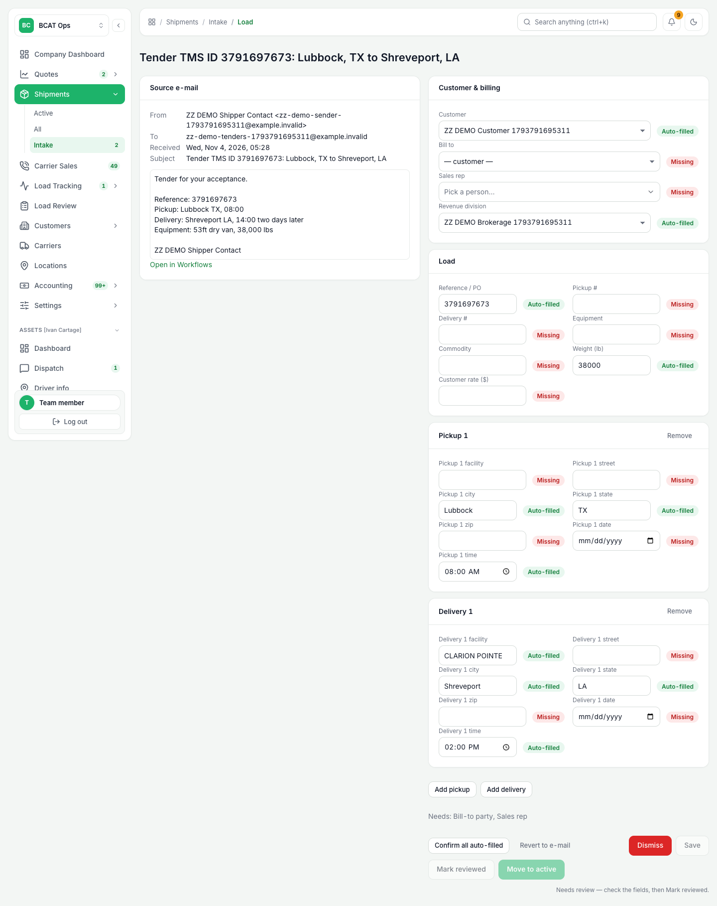 |
| 3 | Fields filled, not yet reviewed: still blocked | same | (fill and Save) | Move to active disabled, Mark reviewed enabled; server: "still needs: review (open the load and press Mark reviewed)" | fields saved by API (INTAKE_SAVE_DRAFT, what Save sends); UI shows result | 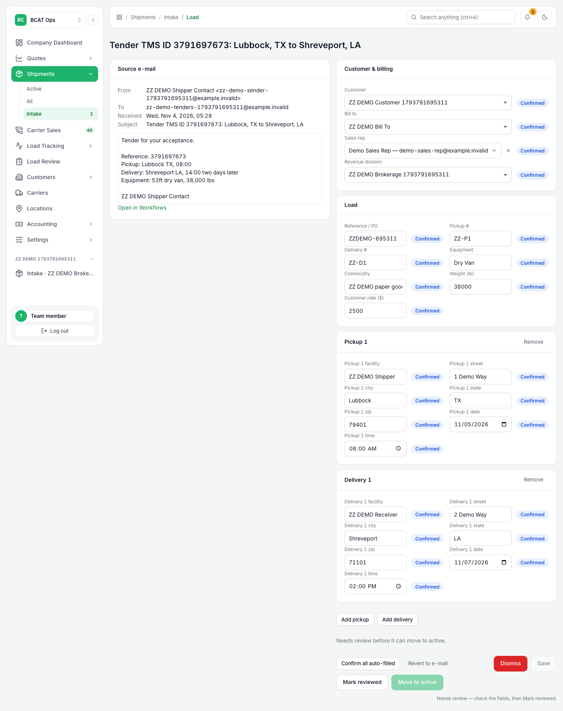 |
| 4 | Load Review: Mark reviewed, then Move to active | same | as the reviewer (page-intakeReview only): **Mark reviewed**, then **Move to active** | "Reviewed by …", Move to active enabled, shipment 99277 created TENDER_PENDING, `Shipment.intakeReviewedBy` = reviewer | UI | 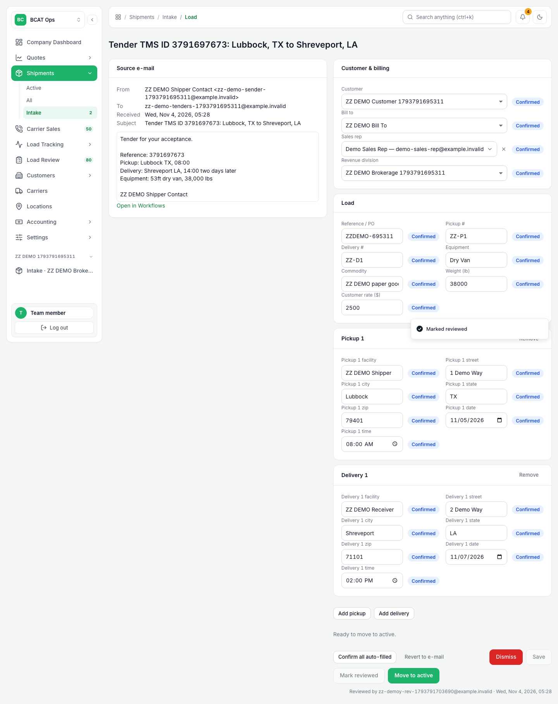 |
| 5 | Accept the tender, it needs cover | https://dev.d3dejqzs77khq6.amplifyapp.com/tms/shipments/shp-49cfb69a-0dfa-4544-8ba8-b666aa771a95 | (Accept tender) | status OPEN, appears in Carrier Sales › Needs cover | accept by API (TENDER_RESPOND) | 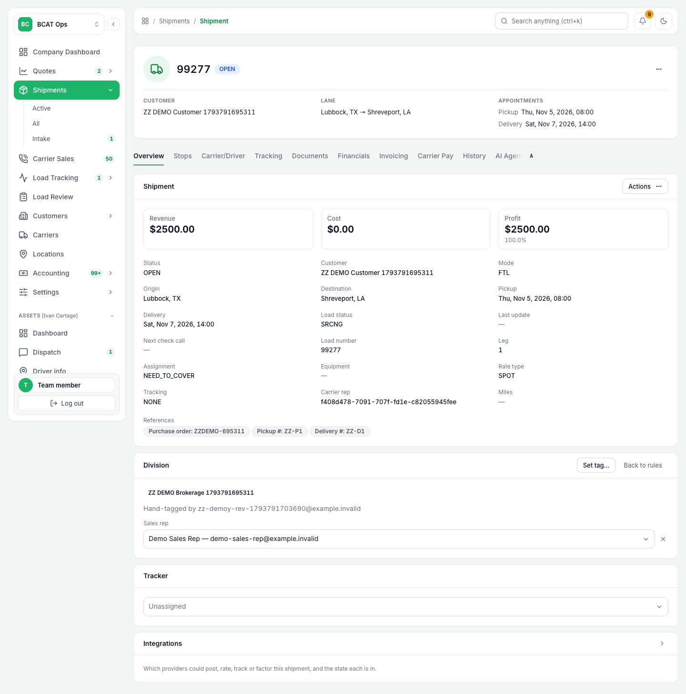  |
| 6 | Carrier packet (MyCarrierPackets) | https://dev.d3dejqzs77khq6.amplifyapp.com/tms/carriers/1793791732092-r87wwv5pw, https://dev.d3dejqzs77khq6.amplifyapp.com/tms/brokerage/integrations/MYCARRIERPACKETS | Validate on the integration; Send setup packet | **MCP mode: LIVE** (Validate: CONNECTED / OK). The live invitation call was made and MCP answered HTTP 400 for the made-up ZZ DOT, so "sent: false" (no real carrier was invited). Rate con is refused until the packet is complete, with MCP's own sentence | API; UI shots | 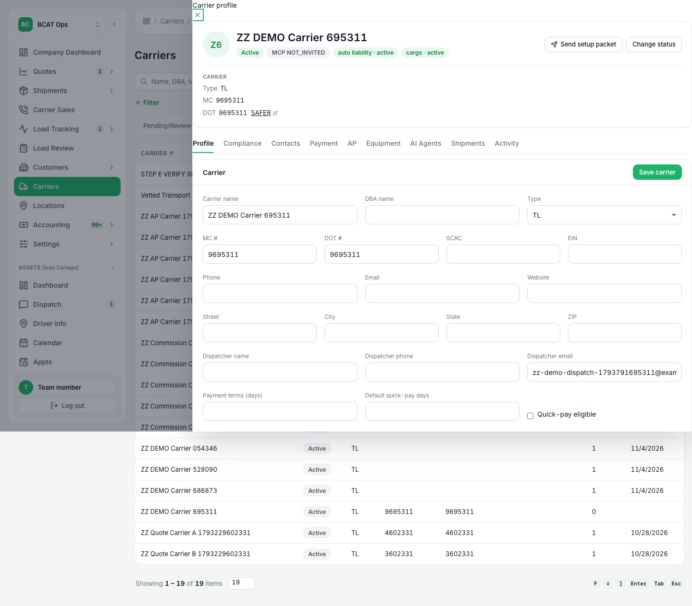  |
| 7 | Cover | https://dev.d3dejqzs77khq6.amplifyapp.com/tms/shipments/shp-49cfb69a-0dfa-4544-8ba8-b666aa771a95?tab=carrier | Book carrier ($1,800.00 carrier rate) | shipment BOOKED | API (BOOK_CARRIER) |  |
| 8 | Packet complete, rate con, carrier signs | same; public link on the carrier tab ("Copy link") | Send rate con; carrier opens link, fills trip details, types name, Sign | status SENT then SIGNED. On dev the e-mail row reads NOT SENT (no SES) | MCP "complete" status stood in (the nightly MCP sync writes it); send by API; **signing is UI on the public page** | 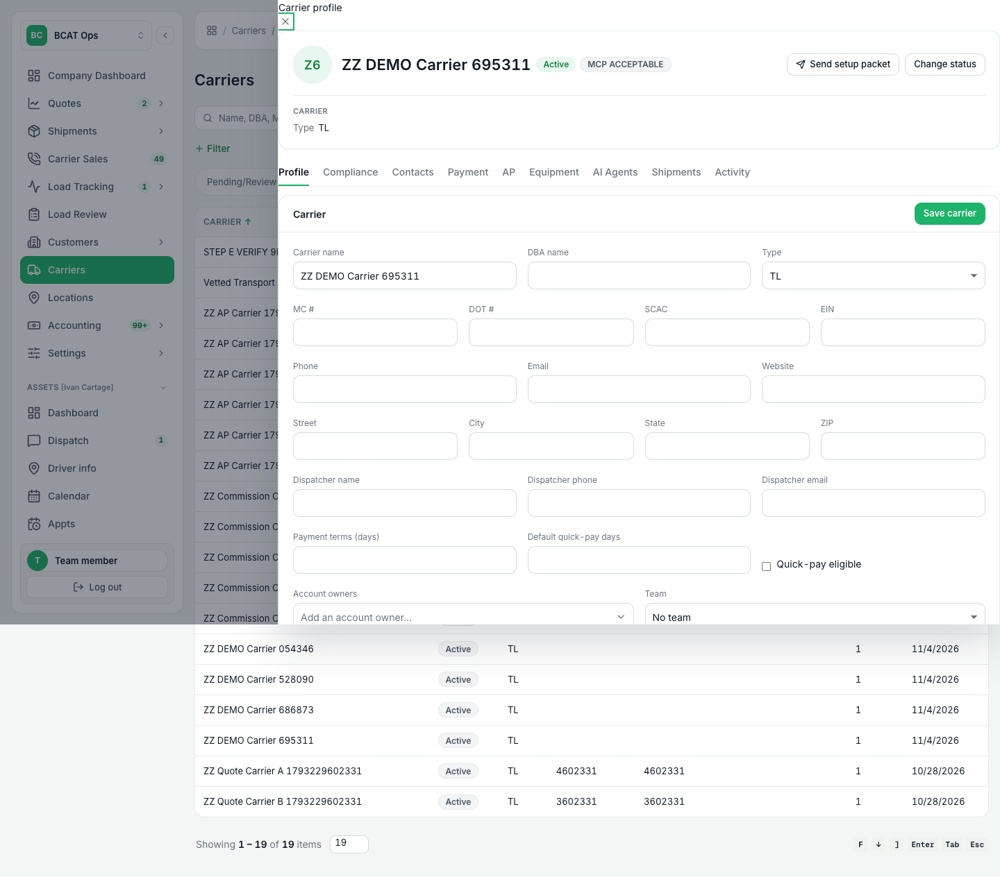    |
| 9 | Tracking by assignee, auto check-call, POD settings | https://dev.d3dejqzs77khq6.amplifyapp.com/tms/tracking?assignee=(tracker id), https://dev.d3dejqzs77khq6.amplifyapp.com/tms/shipments/shp-49cfb69a-0dfa-4544-8ba8-b666aa771a95?tab=tracking, https://dev.d3dejqzs77khq6.amplifyapp.com/tms/brokerage | Tracking › assignee tab; Run check call now; Settings › General & automation | Row under its tracker; plan card; "Automatic check calls" and "Request the POD automatically" settings | tracker, per-load plan, dispatch, Run now by API; UI shots |  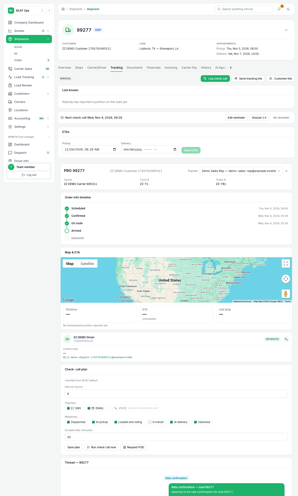  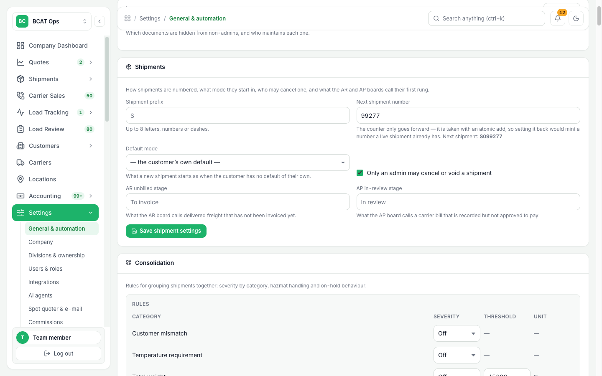 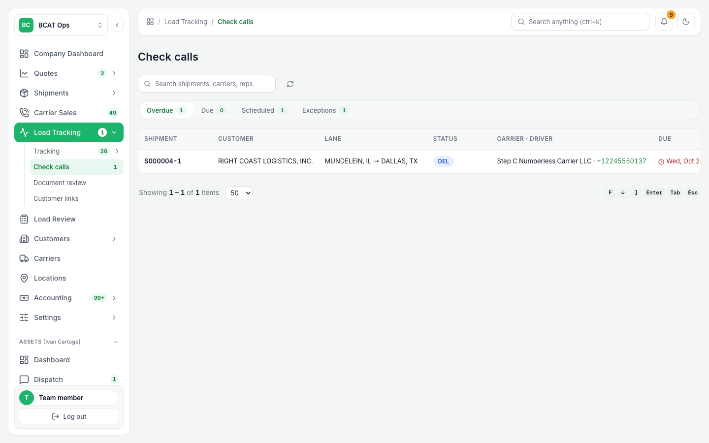 |
| 10 | Delivered, POD | https://dev.d3dejqzs77khq6.amplifyapp.com/tms/shipments/shp-49cfb69a-0dfa-4544-8ba8-b666aa771a95?tab=documents | — | Delivered; BOL + POD on file ("Ready to invoice"); POD requested from the carrier | check calls, POD request, uploads by API | 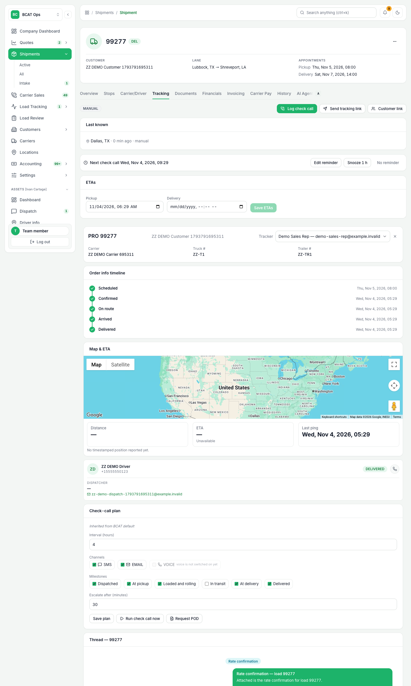  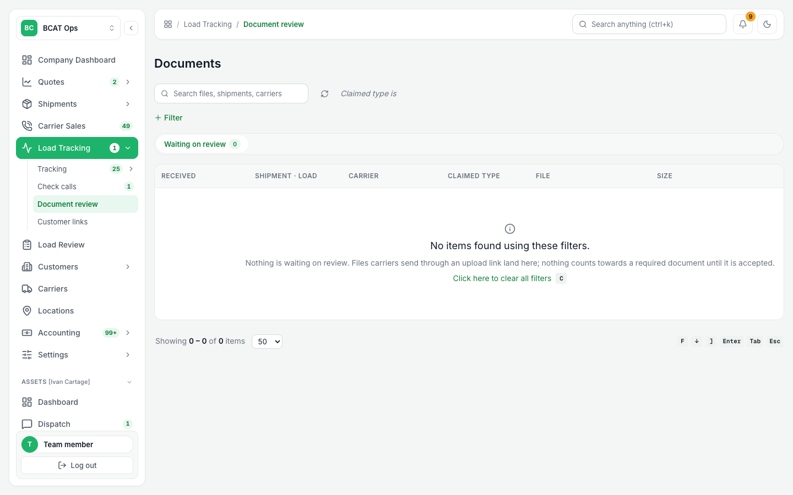 |
| 11 | Release (Load Review release gate) | https://dev.d3dejqzs77khq6.amplifyapp.com/tms/load-review?shipment=shp-49cfb69a-0dfa-4544-8ba8-b666aa771a95 | as a user with only **page-loadReview**: open the load, **Move to billing** | First "Carrier charges not settled: … record the carrier bill first", then green; order becomes UNBILLED, row under Released | UI |    |
| 12 | Invoice (20000 series) | https://dev.d3dejqzs77khq6.amplifyapp.com/tms/invoicing/invoices/20002 | Generate invoice | 20002, ISSUED, $2,500.00 | API |   |
| 13 | Carrier bill | https://dev.d3dejqzs77khq6.amplifyapp.com/tms/invoicing/payable/bills/(bill id) | Accounting › Accounts Payable | $1,800.00 bill, TO_BE_PAID | API (recorded before release, see Open questions) |  |
| 14 | Factoring row | https://dev.d3dejqzs77khq6.amplifyapp.com/tms/factors | Send to Factor | Row NEED_TO_FACTOR, source TMS, no OTR submission | API |  |

## B. Own-asset: Ivan Cartage with a driver (99278)

| # | Step | URL | What you click | Expected | Shot |
|---|---|---|---|---|---|
| 1 | Load with no driver | https://dev.d3dejqzs77khq6.amplifyapp.com/tms/shipments/shp-472a7ac0-5a1b-49df-b42f-da44c290b4c6 | Overview | Ivan Cartage (ASSETS) load, nobody on it. API: dispatch → "Only a booked load can be dispatched"; assign with no driver → refused |  |
| 2 | Driver required | same | Actions › Book Ivan Cartage (own fleet) | **Book own fleet is disabled until a driver is picked**; pick the ZZ driver, click it (UI) |    |
| 3 | Schedule | https://dev.d3dejqzs77khq6.amplifyapp.com/schedule, https://dev.d3dejqzs77khq6.amplifyapp.com/calendar | — | The load is under the driver (Pro# 99278) |   |
| 4 | Dispatch | https://dev.d3dejqzs77khq6.amplifyapp.com/tms/shipments/shp-472a7ac0-5a1b-49df-b42f-da44c290b4c6?tab=carrier | Dispatch | Dispatched (by API), then delivered through check calls |  |
| 5 | Driver settlement = payroll | https://dev.d3dejqzs77khq6.amplifyapp.com/owner-operator-pay | Assets › Owner Operator Settlements, pick the driver | Line 99278, 25% driver share ($345.00 after the 2% factoring fee); banner "Payroll runs every Wednesday · Pay date is today · Covers Sun Oct 25 – Sat Oct 31". Carrier Pay tab says own-fleet pay goes through a settlement |    |
| 6 | Not in Vendors | https://dev.d3dejqzs77khq6.amplifyapp.com/tms/vendors | Accounting › Vendors | Notice: driver settlements and payroll (every Wednesday) → Assets › settlements |  |

The only pay-bearing rows written are the ZZ driver and its pay setting (`zz-demo-…` keys, payPercent 0.25 = 25%). No pay-period rows, no real pay history.

## Defects found / fixed / deploy-pending (lead deploys; all have tests that fail before the fix)

1. **POD review and the shipment thread fail on every real shipment** — `REVIEW_SHIPMENT_POD`: "not authorized to perform dynamodb:BatchGetItem on …Load…". `tmsTrackingActions` reads shipments through the shared `readBundle` (BatchGet on Load and LoadFinancials) with no grant and no `LOAD_FINANCIALS_TABLE_NAME`. Fix in `amplify/backend.ts`; guard `amplify/trackingReadBundleIam.test.ts`. Until deployed the app's automatic POD check could not be shown; the POD was placed and accepted as a document.
2. **Intake-moved loads can never be released** — intake wrote the PO under code `po`; the release gate compares exactly with `PO` (org default). Fix `intake.ts` (`PO`), test updated. The demo order was re-keyed by a data patch on the ZZ order only.
3. **"Run check call now" on a delivered or idle load fails** with "Transaction cancelled [ValidationError]": `nextCheckCallAt` (sort key of the worklist index) was written as NULL. Fix `checkCallAgent.ts` (remove the attribute); the test emulator now models the index's sort key (it hid the bug) and an existing test pinned it.
4. **A per-load check-call plan is ignored** by the shipment Tracking tab and the agent (saved as JSON text, read as an object; shot 15 shows "inherited, every 4 h" after saving 2 h). Fix `normalizeCheckCallPlan` parses text; test added.
5. **`UPSERT_CUSTOMER` update fails** ("expression attribute value `:aiMemory` is not defined") for a customer with no AI memory. Fix in `tms-directory-actions/handler.ts`; test added.

Touched: `amplify/backend.ts`, `amplify/functions/tms-shipment-actions/intake.ts(+test)`, `amplify/functions/tms-tracking-actions/checkCallAgent.ts`, `testSupport.ts`, `checkCallAgent.test.ts`, `amplify/functions/tms-directory-actions/handler.ts(+test)`, `src/lib/checkCallPlan.ts(+test)`, `amplify/trackingReadBundleIam.test.ts`. Targeted vitest (211 + 142 tests), `tsc -p amplify`, eslint on touched files pass.

## Open questions for Ryne

1. **Order of carrier bill vs release.** You listed release, invoice, then carrier bill; the release gate refuses until the carrier bill is recorded ("Carrier charges not settled"), so the bill is recorded first (approved after the invoice). Keep the gate as is?
2. **Live MCP.** Validate passes, so the packet call is live, but a ZZ carrier cannot complete a packet. Give me a real test carrier (DOT, an e-mail you control) if you want to see an invitation actually go out.
3. Carrier-sales and Tracking screens still show real queues around the ZZ rows; the walkthrough filters by search / assignee. Fine?
4. Should the sales rep and bill-to be required before the tender can even be reviewed (as now), or defaulted from the customer?
5. Leave the ZZ records for you to click through, or run `node scripts/devDemoY.mjs retire` (voids invoice, bill and shipments; archives customer, division; deactivates the driver; the ZZ carrier must be set INACTIVE by hand with a reason)?
